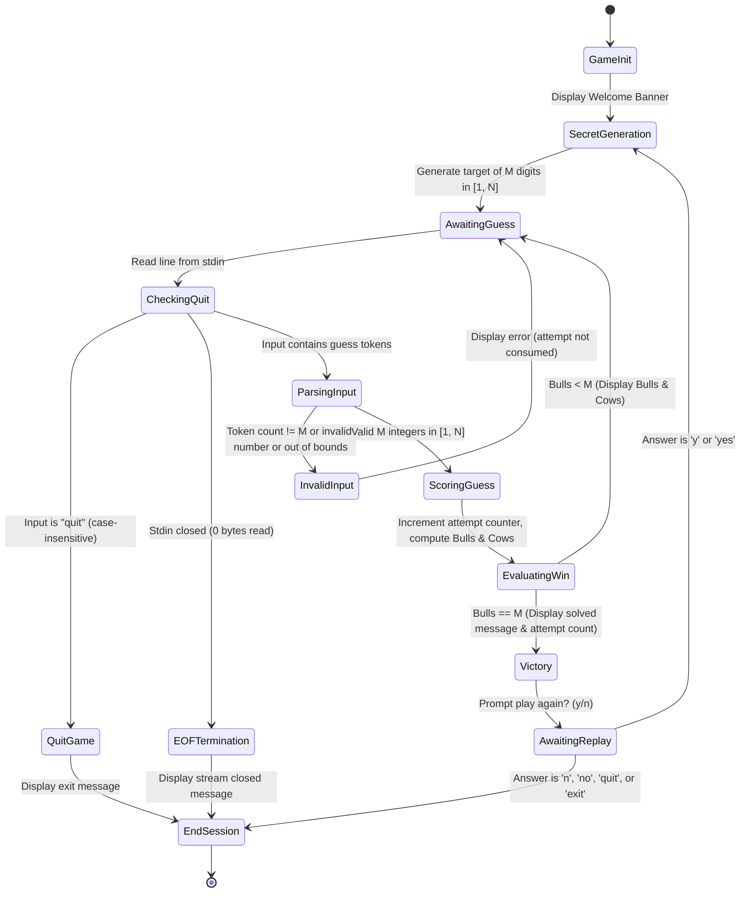

# Design and Algorithm Specification — CS2102 Master Mind

This document specifies the software architecture, algorithmic design, data structures, state machine, and design rationales for the Rust implementation of Master Mind (Bulls & Cows).

---

## 1. Requirements Specification

### Functional Requirements
1. **Target Generation**: The system must generate a secret code of $M$ integers ($M = 4$), with each integer uniformly chosen from $[1, N]$ ($N = 6$). Repetitions must be allowed.
2. **Guess Submission and Parsing**:
   - The user must be able to enter a guess as whitespace-separated text (supporting arbitrary spaces and tabs).
   - The parser must validate token count, whole-number parsing, and numerical boundaries ($1 \le x \le N$).
   - Invalid guesses must output an informative error message and re-prompt without penalizing the user or consuming an attempt.
3. **Scoring Feedback**:
   - The engine must compute the exact number of **Bulls** (correct digit, correct index).
   - The engine must compute the exact number of **Cows** (correct digit, incorrect index).
   - Each digit in the secret code and guess can be matched at most once.
4. **Attempt Tracking**: The game must track and display the number of valid guesses consumed upon winning.
5. **Session Control**:
   - The user can quit the current game at any prompt by entering `quit`.
   - The game must gracefully handle EOF / stream closure without crashing.
   - Upon winning, the user must be prompted to play another round or exit.

### Non-Functional Requirements
1. **Memory Safety & Zero Undefined Behavior**: Strictly 100% safe Rust without `unsafe` blocks.
2. **Robustness & Panic-Free Operation**: User input must never trigger a runtime panic. All errors must be handled via `Result` and user-facing diagnostics.
3. **Efficiency**: Sub-millisecond evaluation for all operations, with $O(M)$ auxiliary space.
4. **Code Quality**: Compliance with standard formatting (`cargo fmt`) and strict compiler checks (`cargo check`).

---

## 2. Function Responsibilities and Signatures

| Function | Signature | Responsibility |
|---|---|---|
| `generate_target` | `fn() -> Vec<u32>` | Samples $M$ random integers in $1..=N$ using `rand::rng()`. Returns owned vector. |
| `parse_guess` | `fn(&str) -> Result<Vec<u32>, String>` | Tokenizes raw input, validates token count, parses integers, enforces range $[1, N]$. |
| `score_guess` | `fn(&[u32], &[u32]) -> (usize, usize)` | Computes Bulls and Cows using a two-pass boolean masking algorithm. |
| `play_game` | `fn(&[u32]) -> bool` | Manages the interactive guess-score loop for a single game round. Returns `true` on win, `false` on quit/EOF. |
| `ask_play_again` | `fn() -> bool` | Queries the user to restart or terminate after a win. |
| `main` | `fn()` | Top-level entry point; prints banner and orchestrates multi-game replay loop. |
| `reference_score` *(Test Only)* | `fn(&[u32], &[u32]) -> (usize, usize)` | Computes Bulls and Cows via frequency histograms and multiset intersection for property testing. |

---

## 3. Data Structures and Representations

```rust
const M: usize = 4; // Code length
const N: u32 = 6;   // Maximum digit value
```

1. **`Vec<u32>` / Slices `&[u32]`**:
   - Target and guess codes are represented as contiguous sequences of `u32`.
   - `u32` provides sufficient range for positive integers while avoiding the signedness ambiguity of `i32`.
   - Borrowed slices `&[u32]` are passed to scoring and gameplay functions to avoid heap cloning and maintain idiomatic read-only access.
2. **Boolean Masks (`Vec<bool>`)**:
   - `target_used: Vec<bool>` and `guess_used: Vec<bool>` track matched positions in `score_guess`.
   - Initialized as `vec![false; M]`. Heap overhead is negligible (8 bytes).
3. **Compound Return Types (`(usize, usize)`)**:
   - Tuples represent the pair `(bulls, cows)` cleanly without the boilerplate of an ad-hoc struct.
4. **Error Handling (`Result<Vec<u32>, String>`)**:
   - Standard `Result` idiom cleanly distinguishes successful parse output (`Ok(guess)`) from validation failure messages (`Err(reason)`).

---

## 4. Algorithms and Pseudocode

### A. Primary Scoring Algorithm (`score_guess`)

```text
Algorithm: ScoreGuess(target: Array[u32], guess: Array[u32]) -> (Bulls: Integer, Cows: Integer)
Input: target of length M, guess of length M
Output: tuple (Bulls, Cows)

1. Assert Length(target) == Length(guess)
2. target_used ← Array of Boolean of size M, initialized to False
3. guess_used  ← Array of Boolean of size M, initialized to False
4. bulls ← 0
5. cows  ← 0

// Pass 1: Identify and record exact positional matches (Bulls)
6. For i from 0 to M - 1:
7.     If target[i] == guess[i]:
8.         bulls ← bulls + 1
9.         target_used[i] ← True
10.        guess_used[i]  ← True

// Pass 2: Match remaining digits in different positions (Cows)
11. For i from 0 to M - 1:
12.    If guess_used[i] == True:
13.        Continue to next i
14.    For j from 0 to M - 1:
15.        If target_used[j] == False and guess[i] == target[j]:
16.            cows ← cows + 1
17.            guess_used[i]  ← True
18.            target_used[j] ← True
19.            Break inner loop

20. Return (bulls, cows)
```

### B. Reference Scoring Algorithm (`reference_score`)

```text
Algorithm: ReferenceScore(target: Array[u32], guess: Array[u32]) -> (Bulls: Integer, Cows: Integer)
Input: target of length M, guess of length M
Output: tuple (Bulls, Cows)

1. bulls ← Count indices i where target[i] == guess[i]
2. target_counts ← Array of size (N + 1), initialized to 0
3. guess_counts  ← Array of size (N + 1), initialized to 0
4. For each value in target:
5.     target_counts[value] ← target_counts[value] + 1
6. For each value in guess:
7.     guess_counts[value] ← guess_counts[value] + 1

// Multiset intersection
8. total_matches ← 0
9. For value from 1 to N:
10.    total_matches ← total_matches + Min(target_counts[value], guess_counts[value])

11. cows ← total_matches - bulls
12. Return (bulls, cows)
```

### C. Input Validation Algorithm (`parse_guess`)

```text
Algorithm: ParseGuess(line: String) -> Result<Array[u32], ErrorMessage>
Input: Raw string line from terminal
Output: Ok(vector of u32) or Err(descriptive error string)

1. tokens ← Split line on whitespace (tabs, spaces, repeated spaces)
2. If Length(tokens) != M:
3.     Return Err("Please enter exactly M numbers, separated by spaces or tabs.")

4. guess ← Empty Vector of capacity M
5. For each token in tokens:
6.     parsed_value ← Parse token as u32
7.     If parsing fails:
8.         Return Err("'<token>' is not a valid whole number.")
9.     If parsed_value < 1 or parsed_value > N:
10.        Return Err("Every number must be between 1 and N.")
11.    Append parsed_value to guess

12. Return Ok(guess)
```

---

## 5. State Machine and Game Transitions



### State Definitions
1. **`GameInit`**: Program starts, prints banner and instructions.
2. **`SecretGeneration`**: Calls `generate_target()` to produce a fresh random sequence.
3. **`AwaitingGuess`**: Flushes stdout and waits on `stdin().read_line()`.
4. **`CheckingQuit`**: Inspects trimmed input for `"quit"` or EOF.
5. **`InvalidInput`**: Informs user of format error; state returns to `AwaitingGuess` without increasing `attempts`.
6. **`ScoringGuess`**: Invokes `score_guess(&target, &guess)` and increments `attempts`.
7. **`Victory`**: Reached when `bulls == M`. Reports total attempts.
8. **`AwaitingReplay`**: Interactively waits for `y`/`n` response.
9. **`EndSession`**: Prints departure message and exits cleanly with status 0.

---

## 6. Ownership and Borrowing Rationale

1. **Target Immutability**:
   The secret code vector is created once in `main()` via `let target = generate_target();` and passed as an immutable slice `&target` to `play_game(&target)`. This guarantees that neither `play_game` nor any nested logic can inadvertently mutate or leak the secret code.
2. **Read-Only Slices in Scoring**:
   `score_guess` accepts `target: &[u32]` and `guess: &[u32]`. Accepting borrowed slices allows callers to pass references to `Vec<u32>`, stack arrays `&[1, 2, 3, 4]`, or sub-slices without heap allocation.
3. **Local Heap Allocations**:
   The tracking vectors `target_used` and `guess_used` are allocated locally inside `score_guess`. They are automatically deallocated when `score_guess` returns, preventing any memory leaks.
4. **Buffer Reuse in Standard I/O**:
   In `play_game` and `ask_play_again`, `line` and `answer` are passed as `&mut line` to `io::stdin().read_line(&mut line)`. This avoids unnecessary reallocations while ensuring proper memory hygiene.

---

## 7. Complexity Analysis

### Time Complexity
- **`generate_target()`**: Generates $M$ random numbers. Sampling each integer takes $O(1)$ time. Overall: $O(M)$.
- **`parse_guess(line)`**:
  - `split_whitespace()` scans the line of length $L$: $O(L)$.
  - Token count check: $O(1)$.
  - Integer parsing and range validation for $M$ tokens: $O(M \cdot K)$ where $K$ is average token string length.
  - Overall: $O(L + M)$. For terminal inputs where $L < 100$ and $M = 4$, this takes less than 1 microsecond.
- **`score_guess(target, guess)`**:
  - First pass: Linear scan of length $M \implies M$ comparisons.
  - Second pass: Nested loop over unmatched elements $\implies \le (M - \text{bulls})^2$ comparisons.
  - Total comparisons: $\le M + M^2$. For $M = 4$, at most $4 + 16 = 20$ comparisons.
  - Overall: $O(M^2)$ time. For fixed constant $M = 4$, this is effectively $O(1)$.

### Auxiliary Space Complexity
- **`score_guess`**: Allocates two boolean vectors of size $M$ $\implies 2M$ bytes $\implies O(M)$ auxiliary memory.
- **`parse_guess`**: Allocates a vector with pre-allocated capacity $M$ for $M$ integers $\implies 4M$ bytes $\implies O(M)$ auxiliary memory.
- Overall Space: $O(M)$ auxiliary space.

---

## 8. Design Limitations and Justified Alternatives

1. **Two-Pass Boolean Marking vs. Frequency Arrays**:
   - *Alternative*: Constructing frequency maps or arrays of size $N+1$ (as done in `reference_score`).
   - *Design Choice*: The two-pass boolean masking approach in `score_guess` operates entirely on index positions without requiring $N$-sized tables or hash map allocations. For small $M$ ($M=4$), the two-pass algorithm is simpler, cache-friendly, and has zero dependency on $N$.
2. **Compile-Time Constants vs. CLI Arguments**:
   - *Alternative*: Allowing the player to supply flags like `--length 5 --range 8`.
   - *Design Choice*: For the CS2102 laboratory assignment specifications, compile-time constants `M` and `N` enforce predictable game bounds and eliminate external CLI argument parsing dependencies.
3. **Terminal Standard I/O vs. Curses / TUI**:
   - *Alternative*: Implementing a curses-style terminal UI (e.g., `ratatui`).
   - *Design Choice*: Standard line-buffered terminal I/O ensures 100% portability across Windows PowerShell, Linux shells, and automated grading test harnesses without platform-specific terminal quirks.
