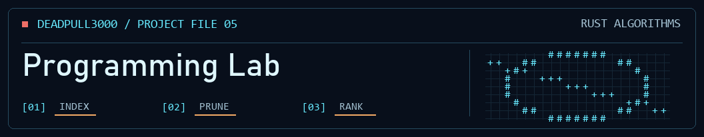

<picture>
  <source media="(prefers-reduced-motion: no-preference)" srcset="./project-scan.gif">
  
</picture>

Compare prefix pruning in Spelling Bee, visited-state backtracking in Boggle, and duplicate-aware feedback in Wordle.

# CS2102 Programming Lab

This repository contains programming projects and laboratory assignments implemented in Rust.

---

## Repository Structure

```text
Programming_Lab/
├── Midterm_Project/
│   └── mastermind/           # Bulls & Cows game engine, property tests, and specs
└── Word Games/
    ├── 1 - Library Trie/     # 26-ary prefix tree with zero-allocation cursors
    ├── 2 - Spelling Bee/     # Bitmask validation and Trie-guided DFS solver
    ├── 3 - Boggle/           # 8-directional backtracking board solver
    ├── 4 - Wordle/           # Entropy solver and candidate elimination engine
    ├── arcade-server/        # Local WebSocket / HTTP game engine backend
    ├── desktop/              # Flippable diary GUI (React + TypeScript)
    ├── docs/                 # Standardized 10-part technical documentation suite
    └── Resources/            # Wordlists, lexicons, and assignment specifications
```

---

## Projects Overview

### 1. [Midterm Project: Master Mind](./Midterm_Project/mastermind)
An implementation of Master Mind (Bulls & Cows) in idiomatic Rust:
- **Game Engine**: Two-pass exact and positional scoring algorithm with duplicate digit protection.
- **Interactive CLI**: Whitespace-tolerant input parsing, attempt tracking, and replay loop.
- **Testing**: Deterministic unit tests and 10,000-iteration property-based verification against an independent multiset reference model.
- **Documentation**: Comprehensive [Design](./Midterm_Project/mastermind/DESIGN.md), [Development Log](./Midterm_Project/mastermind/DEVELOPMENT_LOG.md), and [Testing](./Midterm_Project/mastermind/TESTING.md) guides.

### 2. [Word Games](./Word%20Games)
A complete, industrial-grade Rust word games suite and cozy desktop arcade:
- **`word-trie`**: Encapsulated 26-ary prefix tree with zero-allocation `TrieCursor<'a>` and post-order recursive memory pruning.
- **`spelling-bee`**: 7-bit bitmask validation, pangram scoring, and instant Trie-guided DFS dictionary search.
- **`boggle`**: Flat 1D cache-friendly board grid, cycle-prevention backtracking, and Trie-guided word discovery.
- **`wordle`**: Exact colored feedback simulation, candidate filtering, and information-theoretic Shannon entropy solver.
- **Desktop Arcade**: Cozy hand-drawn diary UI with flippable pages, sound effects, vector stickers, and full keyboard/mouse navigation.
- **Technical Documentation**: Comprehensive 10-chapter documentation suite in [`docs/`](./Word%20Games/docs).
