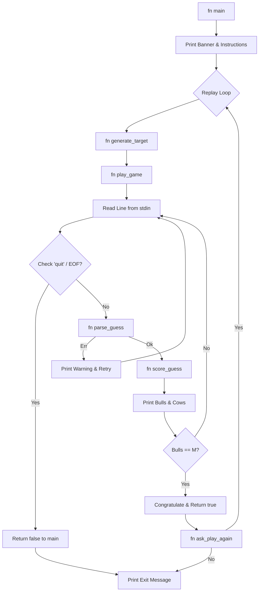

# Master Mind (Bulls & Cows) — CS2102 Mid-Term Project

A robust, idiomatic Rust implementation of the classic code-breaking game **Master Mind** (also known as **Bulls and Cows**), developed for the **CS2102 Programming Lab** course at **Ashoka University**.

---

## 1. Project Overview

The objective of this project is to implement an interactive, terminal-based code-breaking game using the Rust programming language. The game models the classic logic puzzle *Bulls and Cows*:
- The computer randomly selects a secret sequence of $M$ integers, each chosen from the inclusive range $[1, N]$.
- Duplicate numbers are permitted in the secret code.
- The player repeatedly guesses the sequence.
- For each guess, the game returns structured feedback in terms of **Bulls** and **Cows**:
  - **Bull**: A number that is correct in both value and exact position.
  - **Cow**: A number that is present in the secret code, but placed in a different position.
- The game concludes when the player successfully identifies all $M$ numbers in their exact positions ($M$ Bulls) or enters the exit command (`quit`).
- Upon winning, the player is prompted whether they wish to play another round with a newly generated secret code.

The project demonstrates core Rust idioms, including memory safety, ownership, borrowing, pattern matching, error propagation with `Result`, deterministic and randomized testing, and standard Cargo workflow management.

---

## 2. Implemented Features

### Fully Implemented and Verified
- **Pseudo-Random Code Generation**: Generates a secret sequence of length $M$ from range $1..=N$ with uniform range selection using the `rand` crate.
- **Two-Pass Scoring Algorithm (`score_guess`)**: Accurately computes Bulls and Cows while strictly preventing duplicate numbers from being counted more than once.
- **Robust Input Parser (`parse_guess`)**:
  - Accepts tokens delimited by arbitrary whitespace (single spaces, multiple consecutive spaces, tabs, and mixed whitespace).
  - Enforces exact token count ($M$ tokens).
  - Validates integer syntax (rejecting floating-point numbers, negative values, and non-numeric characters).
  - Enforces boundary conditions ($1 \le \text{value} \le N$).
- **Non-Punitive Input Validation**: Invalid guesses display descriptive error messages and prompt the user again without consuming an attempt counter.
- **Graceful Session Handling**:
  - Case-insensitive `quit` command allows the player to exit cleanly during gameplay.
  - End-Of-File (`EOF`) / standard input closure is detected and handled without panics.
- **Replay Loop (`ask_play_again`)**: Interactively queries the player upon winning to start a new game with a fresh target or exit gracefully.
- **Attempt Tracking**: Only valid guesses that are evaluated against the secret code increment the attempt counter.
- **Automated Test Suite**: 6 unit and property tests covering deterministic scoring, repeated digit tracking, randomized equivalence testing (10,000 iterations), parser tolerance, parser rejection, and target bounds.

### Out of Scope / Unimplemented Features
- Graphical User Interface (GUI) or Web Interface (the application is strictly terminal-based).
- Configurable $M$ and $N$ via command-line flags (parameters are declared as compile-time constants `M` and `N`).
- Persistent score storage, high score leaderboards, or file I/O.
- Turn limits or timer-based gameplay modes.

---

## 3. Game Rules and Configuration

### Configuration Parameters
The game parameters are defined in [src/main.rs](file:///c:/Users/User/Downloads/Programming%20Lab/Midterm_Project/mastermind/src/main.rs) as compile-time constants:

```rust
const M: usize = 4; // Secret code length (number of positions)
const N: u32 = 6;   // Maximum allowed value (digits are chosen from 1..=N)
```

- **Allowed values**: Any whole number $x \in \{1, 2, 3, 4, 5, 6\}$.
- **Repetitions**: Numbers may repeat in the secret code (e.g., `1 1 2 2` or `5 5 5 5`).

### Feedback Definitions: Bulls vs. Cows
1. **Bull**: A digit in the player's guess that matches both the value and the exact index of a digit in the secret code.
2. **Cow**: A digit in the player's guess that matches a digit in the secret code, but is situated at a different index.

#### Illustrative Examples

| Secret Code (Target) | Player Guess | Bulls | Cows | Explanation |
|:---:|:---:|:---:|:---:|:---|
| `1 2 3 4` | `1 2 3 4` | 4 | 0 | All digits match their exact positions. |
| `1 2 3 4` | `4 3 2 1` | 0 | 4 | All 4 digits are present, but every digit is misplaced. |
| `1 2 3 4` | `1 2 4 3` | 2 | 2 | `1` and `2` are Bulls; `4` and `3` are Cows. |
| `1 2 3 4` | `5 5 6 6` | 0 | 0 | None of the guessed numbers appear in the target. |
| `1 1 2 2` | `1 2 1 1` | 1 | 2 | Position 0 has Bull (`1`). Position 1 (`2`) matches target position 2 or 3 (Cow). Position 2 (`1`) matches target position 1 (Cow). Position 3 (`1`) cannot be matched because all `1`s in target have been accounted for. |
| `1 1 1 1` | `1 1 2 2` | 2 | 0 | Two `1`s match exactly (2 Bulls). The guessed `2`s are not in the secret code. |
| `1 1 2 2` | `2 2 1 1` | 0 | 4 | All digits match in reverse pairs; 0 Bulls, 4 Cows. |

---

## 4. Prerequisites and Dependencies

### Toolchain Requirements
- **Rust Compiler**: `rustc` version 1.99.0 or higher.
- **Cargo**: `cargo` version 1.99.0 or higher.
- **Rust Edition**: 2024 edition (specified in `Cargo.toml`).

### Dependencies
The project configuration in [Cargo.toml](file:///c:/Users/User/Downloads/Programming%20Lab/Midterm_Project/mastermind/Cargo.toml) declares:

```toml
[package]
name = "mastermind"
version = "0.1.0"
edition = "2024"

[dependencies]
rand = "0.10"
```

As resolved in [Cargo.lock](file:///c:/Users/User/Downloads/Programming%20Lab/Midterm_Project/mastermind/Cargo.lock):
- `rand v0.10.3`: Used for random sequence generation (`rand::rng()` and `rng.random_range(1..=N)`).
- Sub-dependencies managed by Cargo include `chacha20 v0.10.2`, `getrandom v0.4.3`, and `rand_core v0.10.1`.

---

## 5. Project Structure

```text
mastermind/
├── Cargo.lock          # Concrete dependency tree with locked crate versions
├── Cargo.toml          # Cargo manifest defining metadata, edition, and dependencies
├── src/
│   └── main.rs         # Complete application source code and unit tests
├── README.md           # Primary user and developer documentation
├── TESTING.md          # Comprehensive testing, verification, and bug report
├── DESIGN.md           # Architecture, algorithm analysis, and state transitions
└── DEVELOPMENT_LOG.md  # Reproducible build log and terminal command audit
```

### File Responsibilities
- [src/main.rs](file:///c:/Users/User/Downloads/Programming%20Lab/Midterm_Project/mastermind/src/main.rs): Houses constants (`M`, `N`), scoring logic (`score_guess`), input parsing (`parse_guess`), target generation (`generate_target`), game loop logic (`play_game`), replay prompt (`ask_play_again`), entry point (`main`), and test module (`mod tests`).
- [Cargo.toml](file:///c:/Users/User/Downloads/Programming%20Lab/Midterm_Project/mastermind/Cargo.toml): Declares package name, version, edition, and dependencies.
- [Cargo.lock](file:///c:/Users/User/Downloads/Programming%20Lab/Midterm_Project/mastermind/Cargo.lock): Ensures reproducible builds by recording exact package hashes.

---

## 6. Installation and Execution

### Step 1: Open Terminal in Project Directory
Navigate to the directory containing the project:
```bash
cd "c:\Users\User\Downloads\Programming Lab\Midterm_Project\mastermind"
```

### Step 2: Verify the Toolchain
Check that the compiler and build system are present:
```bash
rustc --version
cargo --version
```

### Step 3: Check Code Formatting
Ensure the codebase adheres to standard Rust formatting:
```bash
cargo fmt --check
```

### Step 4: Run Static Analysis and Type Checking
Validate compilation without producing binary artifacts:
```bash
cargo check
```

### Step 5: Execute Automated Unit and Property Tests
Run the entire automated test suite:
```bash
cargo test
```

### Step 6: Run the Interactive Game
Launch the debug binary for gameplay:
```bash
cargo run
```

### Step 7: Build Optimized Release Binary
To compile an optimized production binary:
```bash
cargo build --release
```
The compiled executable will be located at:
- Windows: `target/release/mastermind.exe`
- Linux/macOS: `target/release/mastermind`

---

## 7. How to Play

### User Interaction Rules
1. Upon launch, a welcome banner and instructions are displayed.
2. The computer selects a hidden sequence of 4 numbers between 1 and 6. The secret code is never displayed during normal gameplay.
3. At the prompt, enter 4 numbers separated by spaces or tabs:
   ```text
   Enter 4 numbers from 1 to 6, separated by spaces or tabs (or type 'quit'): 1 2 3 4
   ```
4. The system evaluates the guess and prints the result:
   ```text
   Result: 1 Bull(s), 2 Cow(s).
   ```
5. If the guess is malformed (e.g. fewer than 4 numbers, numbers outside $[1, 6]$, or non-numeric tokens), an error message is printed and the attempt is **not** counted.
6. To exit the game at any prompt, type `quit` (case-insensitive).
7. When all 4 digits match their positions (4 Bulls), the game announces:
   ```text
   Correct! You solved the code in X valid guess(es).
   ```
8. The game asks whether you wish to play again:
   ```text
   Would you like to play again? (y/n): 
   ```
   - Enter `y` or `yes` to generate a new secret code and start a fresh round.
   - Enter `n`, `no`, `quit`, or `exit` to terminate the program.

### Captured Terminal Output (Real Execution)

```text
====================================
       MASTER MIND: BULLS & COWS
====================================
I'm thinking of 4 numbers, each between 1 and 6.
Numbers may repeat.
A Bull means the number and position are correct.
A Cow means the number is correct but the position is not.
Type 'quit' during a guess to exit.

A new secret code has been selected.

Enter 4 numbers from 1 to 6, separated by spaces or tabs (or type 'quit'): Invalid guess: Please enter exactly 4 numbers, separated by spaces or tabs.

Enter 4 numbers from 1 to 6, separated by spaces or tabs (or type 'quit'): You chose to quit the current game.

Thanks for playing!
```

---

## 8. Program Architecture

Control flow proceeds sequentially through modular, single-responsibility functions:



### Function Specifications
1. **`fn generate_target() -> Vec<u32>`**
   - Uses `rand::rng()` to draw $M$ integers in $1..=N$.
   - Returns an owned `Vec<u32>`.
2. **`fn parse_guess(line: &str) -> Result<Vec<u32>, String>`**
   - Splits input on arbitrary whitespace (`split_whitespace()`).
   - Verifies exact length ($M$).
   - Parses each token as `u32` with `map_err`.
   - Validates that each number lies within $1..=N$.
   - Returns `Ok(Vec<u32>)` or a user-friendly `Err(String)`.
3. **`fn score_guess(target: &[u32], guess: &[u32]) -> (usize, usize)`**
   - Accepts borrowed slices `&[u32]`.
   - Runs two independent passes with boolean flags to avoid double-counting.
   - Returns a `(bulls, cows)` tuple.
4. **`fn play_game(target: &[u32]) -> bool`**
   - Manages the interactive prompt for a single secret code.
   - Tracks valid attempt count.
   - Returns `true` if the player won, or `false` if they quit or closed stdin.
5. **`fn ask_play_again() -> bool`**
   - Prompts the user with `(y/n)` upon a win.
   - Returns `true` to restart or `false` to exit.
6. **`fn main()`**
   - Top-level orchestration loop.

---

## 9. Algorithm Explanation

### The Challenge of Duplicate Digits
When secret codes and guesses contain repeated digits (e.g., Target: `[1, 1, 2, 2]`, Guess: `[1, 2, 1, 1]`), naive frequency counting or single-pass checking easily leads to counting an exact match as both a Bull and a Cow, or counting a single target digit against multiple guess digits.

### Two-Pass Solution in `score_guess`

```rust
fn score_guess(target: &[u32], guess: &[u32]) -> (usize, usize) {
    let mut target_used = vec![false; target.len()];
    let mut guess_used = vec![false; guess.len()];
    let mut bulls = 0;
    let mut cows = 0;

    // Pass 1: Count exact matches (Bulls)
    for i in 0..target.len() {
        if target[i] == guess[i] {
            bulls += 1;
            target_used[i] = true;
            guess_used[i] = true;
        }
    }

    // Pass 2: Match remaining digits in different positions (Cows)
    for i in 0..guess.len() {
        if guess_used[i] {
            continue;
        }
        for j in 0..target.len() {
            if !target_used[j] && guess[i] == target[j] {
                cows += 1;
                guess_used[i] = true;
                target_used[j] = true;
                break;
            }
        }
    }

    (bulls, cows)
}
```

#### Step-by-Step Walkthrough
Suppose Target = `[1, 1, 2, 2]` and Guess = `[1, 2, 1, 1]`:
1. **Pass 1 (Bulls)**:
   - Index 0: `target[0] == 1` and `guess[0] == 1` $\rightarrow$ Match! `bulls = 1`, `target_used[0] = true`, `guess_used[0] = true`.
   - Index 1: `1 != 2` $\rightarrow$ No match.
   - Index 2: `2 != 1` $\rightarrow$ No match.
   - Index 3: `2 != 1` $\rightarrow$ No match.
   - Status after Pass 1: `bulls = 1`. `target_used = [T, F, F, F]`, `guess_used = [T, F, F, F]`.
2. **Pass 2 (Cows)**:
   - Guess Index 0: Skipped (`guess_used[0]` is true).
   - Guess Index 1 (`guess[1] == 2`):
     - Scan target indices $0..4$. Target index 2 has `target[2] == 2` and `!target_used[2]`.
     - Match! `cows = 1`, `guess_used[1] = true`, `target_used[2] = true`. Inner loop terminates (`break`).
   - Guess Index 2 (`guess[2] == 1`):
     - Target index 1 has `target[1] == 1` and `!target_used[1]`.
     - Match! `cows = 2`, `guess_used[2] = true`, `target_used[1] = true`. Inner loop terminates (`break`).
   - Guess Index 3 (`guess[3] == 1`):
     - Scan target indices: index 0 is used; index 1 is used; index 2 is used; index 3 has value `2` (does not match `1`).
     - No match found.
3. **Result**: `(1 Bull, 2 Cows)`. Exactly correct.

### Complexity Analysis
- **Time Complexity**:
  - Pass 1 runs in $O(M)$ time where $M$ is sequence length.
  - Pass 2 runs nested loops with worst-case $(M - \text{bulls})^2$ comparisons, which is bounded by $O(M^2)$.
  - For $M = 4$, the maximum number of comparisons is $4 + 16 = 20$ operations, which is $O(1)$ constant time.
- **Auxiliary Space Complexity**:
  - Two boolean tracking vectors of length $M$: $O(M)$ auxiliary memory.
  - For $M = 4$, this consumes only 8 bytes of heap memory, which is negligible.

---

## 10. Rust Concepts Demonstrated

1. **`let` and `let mut`**: Variables are immutable by default (`let target = generate_target()`). Mutability is explicitly scoped where state must evolve (`let mut attempts = 0; let mut line = String::new();`).
2. **Constants and Primitive Types**: `const M: usize = 4;` and `const N: u32 = 6;` demonstrate compile-time constants. Types like `usize`, `u32`, and `bool` ensure type safety across index operations.
3. **Ownership and Borrowing**: Slices `&[u32]` are borrowed by `score_guess` and `play_game` without copying or consuming the underlying vector. Functions return owned collections (`Vec<u32>`) where newly created data must transfer ownership.
4. **Immutable vs. Mutable References**: Immutable borrows (`target: &[u32]`) enable concurrent read-only inspection. Mutable borrows (`&mut answer`, `&mut line`) grant in-place modification permissions to standard I/O functions.
5. **Vectors and Indexing**: Fixed-length vectors initialized using `vec![false; target.len()]` and dynamically populated with `guess.push(value)` show safe collection management.
6. **Tuples**: The compound return type `(usize, usize)` cleanly groups related return values without requiring a single-use custom struct.
7. **`Result`, `Ok`, `Err`, and Error Mapping**: `parse_guess` returns `Result<Vec<u32>, String>`, transforming standard parse errors into informative strings using `.map_err(|_| format!("..."))?`.
8. **Pattern Matching**: Exhaustive `match` expressions handle standard I/O outcomes (`Ok(0)` for EOF, `Ok(_)`, `Err(e)`) and user choices (`"y" | "yes" => true`, `_ => ...`).
9. **Loops and Control Flow**: `loop`, `for i in 0..target.len()`, `continue`, and `break` illustrate clean, idiomatic control flow without recursion.
10. **Standard I/O and Flushing**: `print!` outputs prompts without trailing newlines, and `io::stdout().flush()` ensures text appears immediately before blocking for input.
11. **Unit Testing**: Tests placed in `mod tests` with `#[cfg(test)]` compile only during testing, executing assertions (`assert_eq!`, `assert!`) safely.

---

## 11. Error Handling and Input Validation

Input validation in `parse_guess` follows a multi-stage defense-in-depth pipeline:

```rust
// 1. Whitespace normalization and token counting
let tokens: Vec<&str> = line.split_whitespace().collect();
if tokens.len() != M {
    return Err(format!("Please enter exactly {M} numbers, separated by spaces or tabs."));
}

// 2. Numeric parsing per token
let value = token
    .parse::<u32>()
    .map_err(|_| format!("'{token}' is not a valid whole number."))?;

// 3. Range checking per value
if !(1..=N).contains(&value) {
    return Err(format!("Every number must be between 1 and {N}."));
}
```

### Handled Scenarios
- **Whitespace variation**: Spaces, multiple spaces, tabs (`\t`), and leading/trailing whitespace are cleanly handled by `split_whitespace()`.
- **Wrong token count**: Inputs like `1 2 3` (too few) or `1 2 3 4 5` (too many) are rejected.
- **Malformed characters**: Inputs like `1 two 3 4` or `1 2.5 3 4` return parsing error messages.
- **Out-of-range digits**: `0` or `7` are rejected with boundary error messages.
- **Graceful EOF**: If standard input reaches EOF (e.g. piped input terminates or `Ctrl+D`/`Ctrl+Z`), `read_line` yields `Ok(0)`, which triggers a clean termination message rather than an infinite loop.

---

## 12. Limitations and Future Improvements

### Current Limitations
1. **Hardcoded Game Configuration**: $M$ and $N$ are hardcoded constants. Changing sequence length or digit range requires modifying source code and recompiling.
2. **Terminal Exclusivity**: The user interface is strictly plain text in the terminal.
3. **No Turn Limit**: The game allows unlimited attempts until the player either wins or enters `quit`.

### Recommended Future Enhancements
1. **Command-Line Arguments**: Use `clap` to support flags such as `cargo run -- --length 5 --range 8`.
2. **Difficulty Presets**: Offer Easy ($M=3, N=5$), Medium ($M=4, N=6$), and Hard ($M=5, N=8$) modes.
3. **Turn Limit & Scoring**: Add a maximum allowed attempt limit (e.g. 10 guesses) and an attempt-based score multiplier.
4. **ANSI Colored Feedback**: Use terminal colors (e.g., green for Bulls, yellow for Cows) for enhanced visual clarity.
