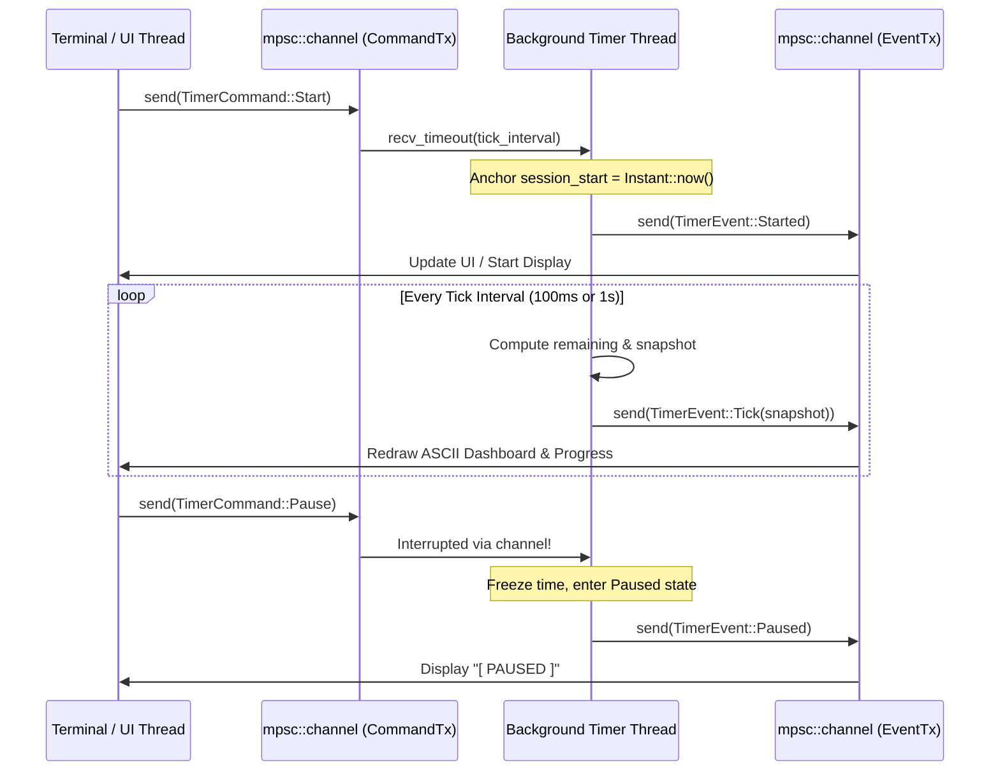

# Technical Design Document: High-Precision Concurrent Countdown Timer

## 1. System Overview & Architectural Motivation

The Countdown Timer is designed as a standalone, zero-dependency, concurrency-safe library and interactive terminal application. It provides:
1. **Drift-Free Monotonic Timing**: Leverages the operating system's monotonic clock (`std::time::Instant`) rather than incremental sleeping, guaranteeing zero cumulative drift.
2. **Interactive Controls & Dual Resolution**: Configurable initial durations up to a defined ceiling (24 hours), pause/resume freezing, resets, dynamic second adjustments, and dual tick resolutions ($1\text{s}$ standard or $100\text{ms}$ sub-second precision).
3. **Large ASCII Format Terminal Display**: 5-line high block-character digital clock with real-time progress bars, status badges, and original preset indicators.
4. **Fearless Concurrency (Rust Book Ch. 16)**: Background worker threads decoupled from non-blocking user input via `std::sync::mpsc` channels and a multi-timer concurrent manager.
5. **Sequential Programmed Routine Engine**: Automated multi-phase execution (e.g. 7-minute scientific exercise routine) with work/rest intervals and acoustic announcements.

---

## 2. Mathematical Timing Analysis & Drift-Free Invariant

### 2.1 The Accumulative Sleep Drift Flaw
A naive timer accumulates time via periodic sleeping:
$$\Delta t_{\text{accum}} = \sum_{k=1}^N \left( \Delta t_{\text{sleep}} + \epsilon_k \right)$$
where $\epsilon_k \ge 0$ represents OS thread scheduling latency, context switching overhead, and event processing delay. Over $N = 1000$ iterations, $\sum \epsilon_k$ typically causes $2\%$ to $5\%$ timing drift.

### 2.2 Monotonic Clock Invariant
Our architecture anchors countdown calculation to the monotonic system clock (`Instant::now()`):
$$\tau_{\text{active}}(t) = \tau_{\text{accumulated}} + \begin{cases} 
t - t_{\text{session\_start}} & \text{if } \text{state} = \text{Running} \\
0 & \text{otherwise}
\end{cases}$$
$$\tau_{\text{remaining}}(t) = \max\left(0, \tau_{\text{preset}} - \tau_{\text{active}}(t)\right)$$

This guarantees:
1. **Zero Cumulative Drift**: Calculation at step $k$ depends strictly on $t_k - t_{\text{start}}$, not on previous loop execution durations.
2. **NTP Immunity**: Because `Instant` uses monotonic timers (Windows `QueryPerformanceCounter`, Linux `CLOCK_MONOTONIC`), system time adjustments, leap seconds, or daylight saving transitions cannot skew or reverse the countdown.

---

## 3. Formal State Machine

```mermaid
stateDiagram-v2
    [*] --> Ready: Initialize(duration)
    
    Ready --> Running: start() [record session_start = Instant::now()]
    Running --> Paused: pause() [accumulate session elapsed, freeze remaining]
    Paused --> Running: resume() [new session_start = Instant::now()]
    
    Running --> Expired: remaining <= 0 [emit bell & alert]
    Paused --> Expired: adjust_seconds(-k) reduces remaining to 0
    
    Running --> Stopped: stop()
    Paused --> Stopped: stop()
    
    Running --> Ready: reset() [accumulated = 0, state = Ready]
    Paused --> Ready: reset()
    Expired --> Ready: reset()
    Stopped --> Ready: reset()
```

### State Definitions
- **`Ready`**: Initialized with preset duration; no system clock elapsed.
- **`Running`**: Active countdown; monotonic clock actively advancing.
- **`Paused`**: Suspended; active session time accrued into `accumulated_active`; remaining time frozen on display.
- **`Expired`**: Active elapsed reached target; sound emitted; display locked at `00:00.0`.
- **`Stopped`**: Manually halted session.

---

## 4. Concurrency Architecture (Rust Book Alignment)

In strict accordance with Chapter 16 of *The Rust Programming Language*, concurrency is built around message passing and decoupled worker threads:



### Concurrency Features
1. **Non-blocking Input**: Keyboard input runs on a dedicated listener thread, transmitting keypresses (`p`, `r`, `+`, `-`, `q`) via `mpsc::channel`. The UI ticks smoothly without blocking on terminal reads.
2. **Instant Responsiveness**: The worker thread utilizes `recv_timeout(tick_interval)`. When the user presses Pause or Reset, the thread wakes immediately on command receipt rather than sleeping out the tick duration.
3. **Safe Memory & Thread Termination**: Graceful thread shutdown is achieved via an `AtomicBool` flag and clean `join()` on drop, eliminating orphaned threads or leaked resources.
4. **Multi-Timer Manager**: The `ConcurrentTimerManager` orchestrates $N$ simultaneous timers running on independent parallel threads, synchronizing updates via `Arc<Mutex<...>>` for live multi-timer monitoring.

---

## 5. Sequential Programmed Timers (Exercise Routine)

The `ExerciseRoutine` engine sequences multiple timers end-to-end to automate intervals:
- **Interval State Model**: `WorkPhase(i) -> RestPhase(i) -> WorkPhase(i+1) ... -> Completed`.
- **Built-in Circuit**: The 11 exercises from the assignment specification:
  - Jumping Jacks ($30\text{s}$, rest $5\text{s}$)
  - Wall Sit ($30\text{s}$, rest $5\text{s}$)
  - Push-ups ($45\text{s}$, rest $15\text{s}$)
  - Crunches ($45\text{s}$, rest $15\text{s}$)
  - Squats ($45\text{s}$, rest $10\text{s}$)
  - Dips ($30\text{s}$, rest $5\text{s}$)
  - Plank ($60\text{s}$, rest $10\text{s}$)
  - Spot running ($60\text{s}$, rest $30\text{s}$)
  - Lunges ($30\text{s}$, rest $5\text{s}$)
  - Side Plank Left ($20\text{s}$, rest $5\text{s}$)
  - Side Plank Right ($20\text{s}$, rest $0\text{s}$)
- **Acoustic Cues**: Emits distinct terminal bell sounds (`\x07`) and console announcements when starting work, switching to rest, and completing the workout.
