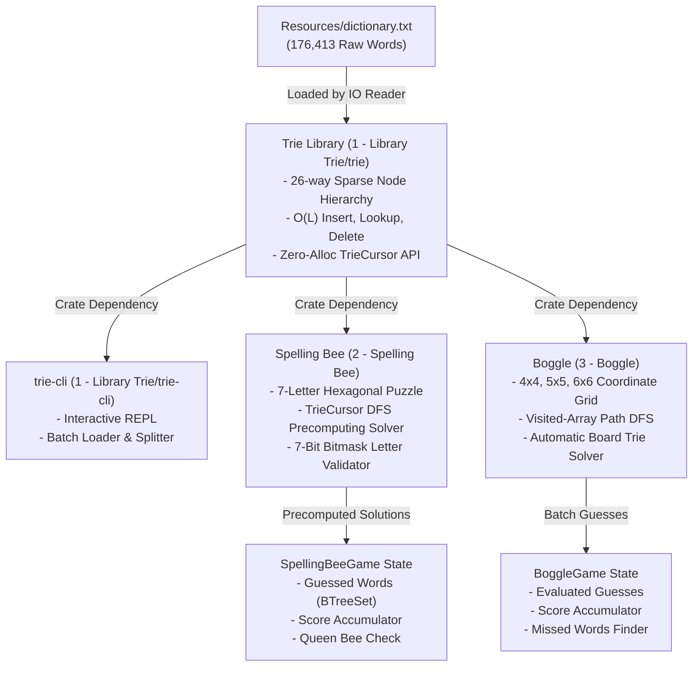
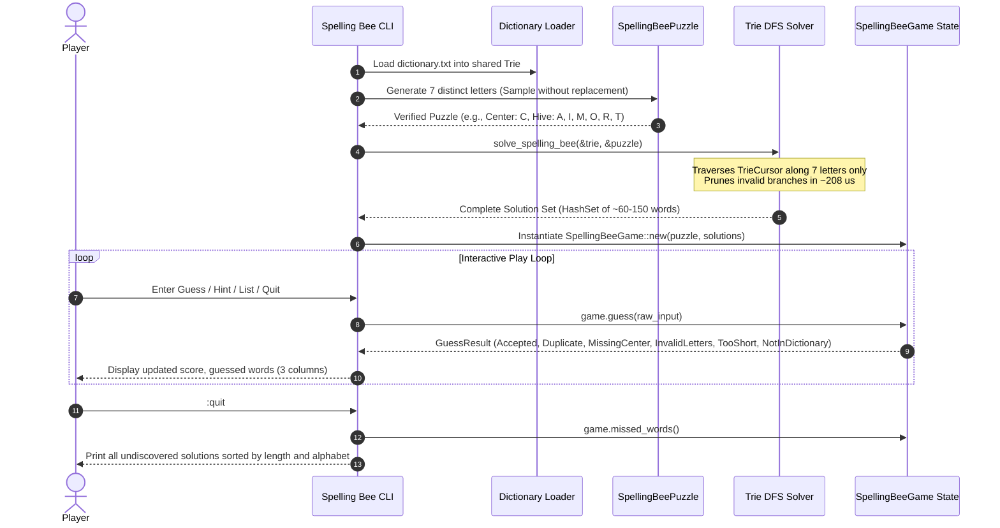
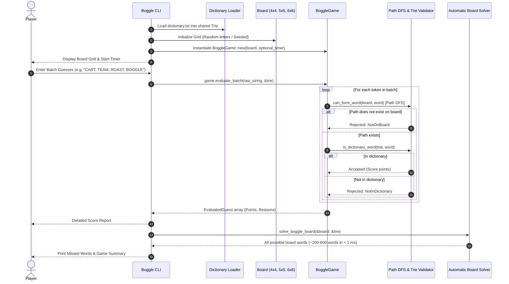

# 02. System Architecture & Component Interaction

This document specifies the software architecture, crate boundaries, data flow pipelines, module encapsulation, and execution workflows across the entire Word Games workspace.

---

## 1. High-Level Workspace Architecture

The system is engineered as a unified Cargo virtual workspace comprising four specialized packages. The core data structure (`trie`) is decoupled into an autonomous, zero-dependency library crate consumed by three distinct downstream applications.



---

## 2. Architectural Design Rationale

### Why the Trie is a Separate Library Crate
1. **Separation of Concerns:** The Trie is an abstract dictionary engine. It has no intrinsic knowledge of word puzzle rules, board geometries, or scoring formulas. Decoupling it into `trie` allows independent evolution, testing, and optimization without triggering recompilation of game code.
2. **Reusability Across Game Engines:** Both Spelling Bee and Boggle require fast prefix queries and dictionary validation. By referencing `trie = { path = "../1 - Library Trie/trie" }`, both games share identical data structure semantics and memory representations.
3. **Encapsulation via `TrieCursor`:** The internal node tree (`pub(crate) struct Node`) contains raw recursive pointers (`[Option<Box<Node>>; 26]`). To prevent client crates from tampering with node linkages or causing memory corruption, traversal is mediated exclusively through a lightweight, read-only `TrieCursor<'a>` bound to the Trie's lifetime.
4. **Standard Library Purity:** The core `trie` crate has zero external dependencies. It relies strictly on Rust's `core` and `alloc` abstractions, maximizing portability and compile-time efficiency.

---

## 3. Dictionary Ingestion & Fallback Path Resolution

To guarantee seamless execution regardless of the terminal's current working directory (whether launched from the workspace root, within a sub-package directory, or via cargo test runners), all applications utilize a multi-tier fallback path resolution:

```rust
const CANDIDATE_PATHS: &[&str] = &[
    "Resources/dictionary.txt",
    "../Resources/dictionary.txt",
    "../../Resources/dictionary.txt",
    "dictionary.txt",
    "../dictionary.txt",
    "../../dictionary.txt",
];
```

The loader iterates sequentially through `CANDIDATE_PATHS`, opening the first existing file via `std::fs::File::open`. An independent buffered reader (`std::io::BufReader`) processes the stream line-by-line, normalizing ASCII characters and populating the Trie.

---

## 4. Source File Inventory & Architectural Responsibilities

| File Path | Architectural Responsibility | Key Structs, Enums & Functions |
| :--- | :--- | :--- |
| **`1 - Library Trie/trie/src/lib.rs`** | Core 26-way prefix tree engine and cursor traversal API | `struct Trie`, `struct Node`, `struct TrieCursor<'a>`, `enum TrieError`, `Trie::insert`, `Trie::contains`, `Trie::remove`, `Trie::has_prefix`, `Trie::root_cursor` |
| **`1 - Library Trie/trie/tests/differential_testing.rs`** | Randomized metamorphic testing against `BTreeSet` | `test_differential_randomized_operations`, `test_alphabet_boundary_extremities` |
| **`1 - Library Trie/trie-cli/src/main.rs`** | Interactive REPL command dispatch and session loop | `main()`, `process_command()`, `Command` parser |
| **`1 - Library Trie/trie-cli/src/batch.rs`** | High-throughput file and token stream parsing | `parse_tokens()`, `load_words_from_reader()`, `check_words_from_reader()` |
| **`2 - Spelling Bee/src/lib.rs`** | Crate root exposing public game engine abstractions | Module re-exports: `SpellingBeeGame`, `SpellingBeePuzzle`, `solve_spelling_bee` |
| **`2 - Spelling Bee/src/puzzle.rs`** | 7-letter puzzle generation, invariants, and bitmask tracking | `struct SpellingBeePuzzle`, `FULL_PANGRAM_MASK`, `MAIN_LETTER_BIT`, `bitmask_for_word()` |
| **`2 - Spelling Bee/src/solver.rs`** | Trie-guided recursive DFS solution precomputation | `solve_spelling_bee()`, `dfs_explore()`, `brute_force_reference_solve()` |
| **`2 - Spelling Bee/src/scoring.rs`** | NYT-compliant scoring rules and pangram bonus evaluation | `calculate_score()`, `PANGRAM_BONUS_POINTS = 7` |
| **`2 - Spelling Bee/src/game.rs`** | Game state machine, guess evaluation, and victory detection | `struct SpellingBeeGame`, `enum GuessResult`, `guess()`, `is_queen_bee()`, `missed_words()` |
| **`2 - Spelling Bee/src/hints.rs`** | Hint grid calculation and 2-letter prefix frequency matrix | `struct SpellingBeeHints`, `struct HintGrid`, `struct TwoLetterPrefixes` |
| **`2 - Spelling Bee/src/main.rs`** | Interactive terminal game loop and 3-column formatter | `main()`, `run_game()`, `format_three_columns()` |
| **`3 - Boggle/src/lib.rs`** | Crate root exposing board, scoring, and solver abstractions | Module re-exports: `Board`, `BoggleGame`, `solve_boggle_board` |
| **`3 - Boggle/src/board.rs`** | NxN grid coordinate geometry and neighbor adjacency lists | `struct Board`, `VALID_DIMENSIONS = [4, 5, 6]`, `DIRECTIONS`, `neighbors_of()` |
| **`3 - Boggle/src/validator.rs`** | Recursive DFS pathfinding and automated Trie board solver | `can_form_word()`, `can_form_word_with_qu()`, `solve_boggle_board()` |
| **`3 - Boggle/src/scoring.rs`** | Official Boggle length scoring and 9+ letter extension policy | `calculate_score()` |
| **`3 - Boggle/src/game.rs`** | Batch evaluation pipeline and round state machine | `struct BoggleGame`, `enum BoggleGuessResult`, `evaluate_batch()` |
| **`3 - Boggle/src/timer.rs`** | Optional non-blocking match countdown timer | `struct BoggleTimer`, `is_expired()`, `remaining_seconds()` |
| **`3 - Boggle/src/main.rs`** | Interactive CLI game loop, setup menus, and batch input | `main()`, `run_game_loop()`, `parse_input_tokens()` |

---

## 5. Execution Flow & Lifecycle Pipelines

### A. Spelling Bee Execution Flow


### B. Boggle Execution Flow

